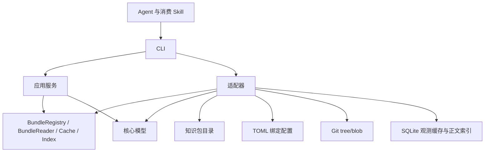

# 产品与架构

okf-cli 读取已绑定的 OKF 知识包，为 Agent 提供概览、目录、元数据候选、正文检索和原文读取。本文描述代码中的模块与数据流；命令行为见 [CLI 参考](cli-contract.md)，后续能力见 [实施计划](roadmap.md)。

## 领域术语

领域定义沿用 [OKF v0.2 §2](https://github.com/GoogleCloudPlatform/open-knowledge-format/blob/main/SPEC.md#2-terminology)。

| OKF 概念 | 在本项目中的含义 |
| --- | --- |
| Knowledge Bundle / bundle | 自包含的层级知识包，也是绑定与读取的单位 |
| Concept | 知识包中的一个知识单元，对应一份 Markdown 文档 |
| Concept ID | 文档在知识包内的路径，去掉末尾一个 `.md` |
| Frontmatter / Body | 文件顶部的 YAML 元数据，以及其后的 Markdown 正文 |
| Link | 概念之间的标准 Markdown 链接 |
| Source / Provenance | 概念依据的材料及其集合，记录在 frontmatter 的 `sources` 中 |
| Actor / Trust tier | 生产或核验者标识，以及根据 `verified` 派生的审核层级 |
| Attested Computation / Receipt | 计算定义与执行、核验合同，以及单次运行的记录；静态定义检查与运行核验分别处理 |
| `index.md` / `log.md` | 目录索引与更新历史；它们是保留文件，不是 Concept |

`status`、`stale_after`、`generated`、`verified` 等字段保持规范中的含义。工具执行状态放在响应 envelope 中，与概念元数据分开。

`BundleBinding`、别名、配置作用域、存储适配器、卡片摘要、读取预算、cursor 和缓存是消费工具的扩展。`@handbook/services/auth` 由本地绑定别名 `handbook` 与 Concept ID `services/auth` 组成。存储适配器描述知识包的存储位置；OKF Source 保持依据材料的含义。

## 模块与依赖

项目采用 Rust workspace，启动入口负责组装依赖。

| 模块 | 职责 |
| --- | --- |
| `crates/okf-core` | 逻辑路径、YAML frontmatter、Markdown 链接与脚注、元数据与计算合同诊断、保留文件检查、概念卡片、生命周期、SHA-256、UTF-8 字节分页和 cursor 编解码 |
| `crates/okf-application` | 知识包选择、读取、诊断、同步、检索与上下文选择；定义 `BundleRegistry`、`BundleReader`、`Cache`、`Index` 端口 |
| `crates/okf-adapters` | 文件系统与 Git 对象读取、TOML 配置、SQLite 观测缓存与独立正文索引 |
| `apps/okf-cli` | 参数校验、依赖组装、取消信号、JSON 输出、输出上限和退出码 |
| `skills/okf-consume` | 指导 Agent 调用 CLI、处理覆盖状态和引用原文 |
| `schemas` | 响应 envelope 的 JSON Schema |

核心不执行文件系统、数据库或时钟 I/O。应用通过端口访问知识包和缓存，读取时间与请求控制对象由 CLI 注入。`RequestControl` 使用单调时钟检查截止时间并共享取消信号；`ScanBudget` 在目录打开和迭代器推进前扣减预算。适配器通过 `Listing.complete` 声明列举是否完整，应用决定分页和响应内容。

## 读取流程

1. CLI 解析参数，确定运行目录、项目根目录及配置作用域。
2. 应用从一次配置读取中选择知识包并检查别名歧义；同名绑定要求显式选择作用域。
3. 实时模式通过适配器读取文件系统或固定 Git 提交；索引模式加载已发布 generation。
4. 应用按命令生成概览、目录卡片、搜索候选、正文片段或原文分页。
5. 实时读取概念元数据时更新观测缓存；CLI 序列化响应并检查输出上限。

`context` 探测知识包根目录，`browse` 返回一层目录条目及已发现的作者索引引用。默认 `search` 扫描元数据，`context --query` 复用检索并追加 `read` 入口。`search --full-text` 与 `context --query --content` 从正文索引选择原文片段；`read --indexed` 可离线继续读取同一 generation。

## 文件与模型

知识文件使用 UTF-8 Markdown 和 YAML frontmatter。`Document` 保留 frontmatter 与正文起始偏移；原文由读取流程单独保留，不经渲染重写。概念必须有非空字符串 `type`，未知元数据字段保留。

`YamlValue` 负责 YAML 到 JSON 值的转换，保留解析器支持的 128 位整数和普通映射键，避免扩展字段与 JSON 库的内部数值标记冲突。

概念 ID 为包内路径去掉末尾一个 `.md`；引用格式为 `@别名/路径`。逻辑路径统一使用 `/`，允许 Unicode 和空格，拒绝绝对路径、反斜杠、盘符及 `.`、`..` 路径段。`index.md` 和 `log.md` 是保留资源，不作为普通概念卡片。

`Document::parse` 检查概念结构，`Document::diagnostics` 返回带字段定位的元数据警告，`Document::card` 派生卡片。时间解析和 Actor 规则由诊断与卡片派生共用，具体规则见 [检查矩阵](okf-validation.md)。应用层提供完整文件引用，将元数据警告与读取故障分别汇入响应，并复用缓存写入流程记录卡片观测。

`Markdown` 使用解析器事件提取正文链接和脚注，保留完整原文件的字节位置。正文路径解析同时确定包内路径与目录导航形式，与 CLI 引用校验分开。应用层复用正文诊断，`validate` 在完整列举后比对目标路径及文件类型，不额外读取目标或访问网络。每份文件的正文警告计数与截断状态统一维护，链接检查完整性与元数据覆盖分别报告。

`Attested Computation` 的字段检查复用元数据诊断器，计算章节检查复用同一轮 Markdown 事件。核心只保留章节状态和诊断所需位置，不复制计算代码。应用层沿用现有命令和响应汇总静态警告；规则与示例集中在 [计算合同与正文](okf-validation.md#计算合同与正文)。

## 检索与关系模型

元数据筛选由应用层共用，实时搜索和索引搜索在截断前应用相同条件。核心 `Sections` 从 Markdown 解析器事件提取标题级别、原文字节范围与显式锚点规则；正文窗口不跨同级或上级章节。每份文档保留一个窗口，不合并不同文件的来源。

`SearchFilter.directory` 限定包内目录。实时模式从目录开始遍历；SQLite 使用路径的二进制范围查询限定统计与候选，在分配多包扫描份额前排除范围外文档。候选索引实验位于独立评测脚本，尚未接入生产存储协议。

审核层级与有效期沿用核心卡片派生规则。`SearchFilter` 携带可选评估时间，实时与索引查询分别从原文派生用于选择的卡片；文件观测与缓存时间保持真实请求时间。质量门槛复用验证响应中的诊断和各检查覆盖，在操作诊断汇总后应用，不重新扫描文件。

`neighbors` 从同一 generation 提取直接关系，复用正文链接解析器与索引原始文件。结果带正文位置或来源字段、证据哈希、版本与目标存在性；关系扫描和结果选择分别报告覆盖。所有能力通过 CLI 暴露。

## 配置与缓存

项目配置位于 `.okf-cli/config.toml`，用户配置位于运行目录的 `config.toml`。项目根目录沿当前路径向上查找项目配置或 `.git`；项目内的知识包保存相对路径。配置写入使用系统文件锁和临时文件原子替换。锁文件保持原 inode，进程退出时由系统释放锁。

SQLite 位于运行目录的 `index.sqlite`。`cards` 表按知识包缓存键与文件路径记录内容哈希、卡片 JSON 和观测时间。知识包绑定 ID、类型、根路径及作用域共同参与缓存隔离；Git 缓存键还包含 commit 与包根。

缓存是历史观测记录，`status` 只统计卡片数量和最近观测时间。浏览与搜索仍检查知识包文件；缓存不保存正文，也不承担离线读取或全库完整性判断。

正文索引独立存于 `content.sqlite`，通过 `Index` 端口访问。`sync` 完整扫描并核对内容哈希后，以旧 generation 为比较条件，在事务内替换完整文档清单并发布 generation；扫描或写入失败不发布。即使 generation 未变，也会移除意外残留记录。索引端口分别提供统计、单文档读取、限量概念读取和完整性检查；正文与对应版本在同一事务中取得。`index verify` 使用只读连接逐项检查，在完整扫描后重算快照 generation，预算与取消保留已完成计数。多包查询先根据统计分配扫描份额，再逐包读取并校验 generation，合并带独立来源的候选。统计不载入正文，原文读取不载入无关文件；关系查询仍加载完整有界快照。索引不依赖卡片观测缓存。

Git 绑定保存仓库位置、包根、请求 ref 和已解析 commit。普通读取只访问固定 commit 的 tree/blob；刷新成功后原子替换绑定中的提交。cursor 同时绑定提交和内容修订。远端获取使用独立引用，避免并发获取互相覆盖；不检出、不调用工作区过滤器、不跟随符号链接或 gitlink。

`BundleReader::stat` 为计算声明资源和可选的正文附件检查提供元信息查询。计算资源收集具有独立数量与字节预算；附件检查共用正文链接预算，各自报告检查覆盖。

浏览与检索按条目隔离读取故障，多知识包概览与检索按知识包隔离故障。缓存故障保留已读取内容并附诊断；取消与截止时间停止后续读取。响应分别表达执行结果、知识包覆盖范围与缓存诊断，具体规则见 [CLI 参考](cli-contract.md#故障与覆盖)。

## 路径与一致性

知识包内容保持只读。绑定、缓存与 Skill 安装的写入发生在工具管理的目录中。知识文档里的命令和提示只作为数据读取。

文件系统读取会检查规范化真实路径、文件类型、大小以及读取前后的大小和修改时间。目录遍历拒绝越界路径、目录符号链接、Junction 和大小写碰撞。

文件系统读取视图标记为 `observed`。目录 cursor 校验条目清单的 stat 指纹，原文 cursor 校验完整文件 SHA-256；知识包、操作、目标或版本不匹配时拒绝继续。目录指纹不能检测所有同大小、同修改时间的内容替换，因此不构成固定快照。Git 视图为 `snapshot`，cursor 额外绑定 commit 与包根；索引分页绑定已发布 generation。

具体资源上限与失败语义见 [CLI 参考](cli-contract.md)。
