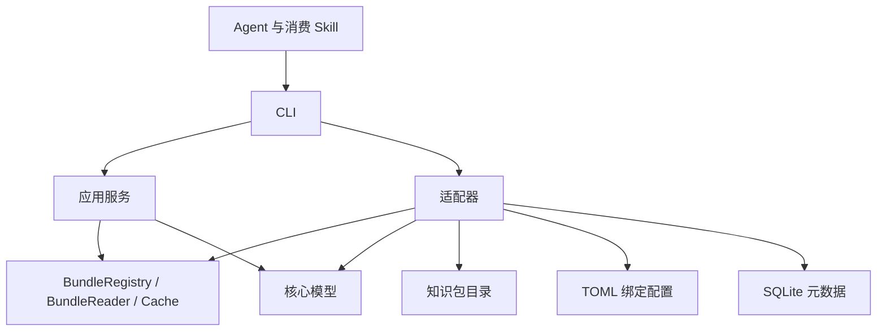

# 产品与架构

okf-cli 读取已绑定的 OKF 知识包，为 Agent 提供概览、目录、元数据候选和原文读取。本文描述代码中的模块与数据流；命令行为见 [CLI 参考](cli-contract.md)，后续能力见 [实施计划](roadmap.md)。

## 领域术语

领域定义沿用 [OKF v0.2 §2](https://github.com/GoogleCloudPlatform/open-knowledge-format/blob/main/SPEC.md#2-terminology)。

| OKF 概念 | 在本项目中的含义 |
| --- | --- |
| Knowledge Bundle / bundle | 自包含的层级知识包，也是绑定与读取的单位 |
| Concept | 知识包中的一个知识单元，对应一份 Markdown 文档 |
| Concept ID | 文档在知识包内的路径，去掉末尾一个 `.md` |
| Frontmatter / Body | 文件顶部的 YAML 元数据，以及其后的 Markdown 正文 |
| Link | 概念之间的标准 Markdown 链接 |
| Source / Provenance | 概念依据的材料及其集合，记录在 frontmatter 的 `sources` 中 |
| Actor / Trust tier | 生产或核验者标识，以及根据 `verified` 派生的审核层级 |
| `index.md` / `log.md` | 目录索引与更新历史；它们是保留文件，不是 Concept |

`status`、`stale_after`、`generated`、`verified` 等字段保持规范中的含义。工具执行状态放在响应 envelope 中，与概念元数据分开。

`BundleBinding`、别名、配置作用域、存储适配器、卡片摘要、读取预算、cursor 和缓存是消费工具的扩展。`@handbook/services/auth` 由本地绑定别名 `handbook` 与 Concept ID `services/auth` 组成。存储适配器描述知识包的存储位置；OKF Source 保持依据材料的含义。

## 模块与依赖

项目采用 Rust workspace，启动入口负责组装依赖。

| 模块 | 职责 |
| --- | --- |
| `crates/okf-core` | 逻辑路径校验、YAML frontmatter、概念卡片、生命周期、SHA-256、UTF-8 字节分页和 cursor 编解码 |
| `crates/okf-application` | 知识包选择、概览、浏览、原文读取、元数据搜索和合规检查；定义 `BundleRegistry`、`BundleReader`、`Cache` 端口 |
| `crates/okf-adapters` | 文件系统读取、TOML 配置和 SQLite 元数据缓存 |
| `apps/okf-cli` | 参数校验、依赖组装、取消信号、JSON 输出、输出上限和退出码 |
| `skills/okf-consume` | 指导 Agent 调用 CLI、处理覆盖状态和引用原文 |
| `schemas` | 响应 envelope 的 JSON Schema |

核心不执行文件系统、数据库或时钟 I/O。应用通过端口访问知识包和缓存，读取时间与请求控制对象由 CLI 注入。`RequestControl` 使用单调时钟检查截止时间并共享取消信号；`ScanBudget` 在目录打开和迭代器推进前扣减预算。适配器通过 `Listing.complete` 声明列举是否完整，应用决定分页和响应内容。

## 读取流程

1. CLI 解析参数，确定运行目录、项目根目录及配置作用域。
2. 应用从一次配置读取中选择知识包并检查别名歧义；同名绑定要求显式选择作用域。
3. 文件系统适配器检查真实路径是否位于知识包根目录内。
4. 应用按命令生成知识包概览、目录卡片、搜索候选或原文分页。
5. 读取概念元数据时更新缓存，CLI 序列化响应并检查输出上限。

`context` 探测知识包根目录，`browse` 返回一层目录条目及已发现的作者索引引用。`search` 扫描元数据；`context --query` 复用检索并追加 `read` 入口。原文由 `read` 显式获取。

## 文件与模型

知识文件使用 UTF-8 Markdown 和 YAML frontmatter。`Document` 保留 frontmatter 与正文起始偏移；原文由读取流程单独保留，不经渲染重写。概念必须有非空字符串 `type`，未知元数据字段保留。

概念 ID 为包内路径去掉末尾一个 `.md`；引用格式为 `@别名/路径`。逻辑路径统一使用 `/`，允许 Unicode 和空格，拒绝绝对路径、反斜杠、盘符及 `.`、`..` 路径段。`index.md` 和 `log.md` 是保留资源，不作为普通概念卡片。

卡片中的 `trust`、`status` 和 `expiry` 分别表达审核声明、文档状态与过期情况。`human:` 前缀来自源文件声明，不是身份认证；非法过期时间派生为 `unknown`。

## 配置与缓存

项目配置位于 `.okf-cli/config.toml`，用户配置位于运行目录的 `config.toml`。项目根目录沿当前路径向上查找项目配置或 `.git`；项目内的知识包保存相对路径。配置写入使用独占锁文件和临时文件原子替换。

SQLite 位于运行目录的 `index.sqlite`。`cards` 表按知识包缓存键与文件路径记录内容哈希、卡片 JSON 和观测时间。知识包绑定 ID、类型、根路径及作用域共同参与缓存隔离。

缓存是历史观测记录，`status` 只统计卡片数量和最近观测时间。浏览与搜索仍检查知识包文件；缓存不保存正文，也不承担离线读取或全库完整性判断。

浏览与检索按条目隔离读取故障，多知识包概览与检索按知识包隔离故障。缓存故障保留已读取内容并附诊断；取消与截止时间停止后续读取。响应分别表达执行结果、知识包覆盖范围与缓存诊断，具体规则见 [CLI 参考](cli-contract.md#故障与覆盖)。

## 路径与一致性

知识包内容保持只读。绑定、缓存与 Skill 安装的写入发生在工具管理的目录中。知识文档里的命令和提示只作为数据读取。

文件系统读取会检查规范化真实路径、文件类型、大小以及读取前后的大小和修改时间。目录遍历拒绝越界路径、目录符号链接、Junction 和大小写碰撞。

读取视图标记为 `observed`。目录 cursor 校验条目清单的 stat 指纹，原文 cursor 校验完整文件 SHA-256；知识包、操作、目标或版本不匹配时拒绝继续。目录指纹不能检测所有同大小、同修改时间的内容替换，因此不构成固定快照。

具体资源上限与失败语义见 [CLI 参考](cli-contract.md)。
